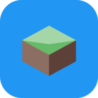

# Voxel Craft

一款原创的 **3D 体素沙盒游戏**（Android）。借鉴经典沙盒「破坏与建造」的核心玩法，但所有代码、渲染器、地形算法与美术资源均从零编写，**不使用任何第三方游戏引擎，也不使用任何外部素材**。

<p align="center">
  
</p>

## 下载安装

- **直接下载 APK**：前往 [Releases](../../releases/latest) 页面下载 `VoxelCraft.apk`，或使用固定链接：

  ```
  https://github.com/wslhx002/killyuxiku/releases/latest/download/VoxelCraft.apk
  ```

- 安装要求：**Android 7.0（API 24）及以上**，支持 OpenGL ES 2.0。
- 当前为 **debug 签名**版本，安装时需在系统设置中允许「安装未知来源应用」。

## 游戏特性

- **手写 3D 渲染器**：基于 OpenGL ES 2.0，按区块（Chunk）网格化，仅生成朝向空气的可见面；不透明与透明方块分两遍绘制，支持水体/玻璃的半透明混合；开启背面剔除与距离雾。
- **PNG 贴图资源**：16 张原创 16×16 像素方块贴图随 APK 打包在 `assets/textures/`，运行时拼成图集上传 GPU。
- **首页**：启动先进入首页（开始游戏 / 玩法说明 / 关于），不会一打开就直接加载世界。
- **程序化地形**：值噪声 + 分形叠加（fBm）生成山地、平原、水域与雪线，并在草地上自动种树。
- **第一人称探索**：重力、跳跃与 AABB 体素碰撞，支持「创造飞行」模式自由穿梭于世界。
- **方块交互**：体素射线检测选中目标方块并高亮线框，可破坏、放置；放置时自动避免把方块卡进玩家身体。
- **14 种方块**：草地、泥土、石头、木头、树叶、沙子、水、木板、鹅卵石、红砖、雪、玻璃、发光石等，全部纹理由代码程序化生成的像素图集。
- **昼夜更替**：天空颜色随时间在日出 / 正午 / 黄昏 / 深夜之间渐变，太阳与月亮在天空中移动，地形整体光照也随之转暖或转冷变暗；左上角 HUD 显示实时时间。
- **移动端 HUD**：自绘准星、虚拟摇杆、破坏/放置/跳跃按钮、飞行开关与顶部物品栏。

## 更新日志

### v1.1（月度更新）
- 新增 **昼夜更替系统**：天空颜色在日出 / 正午 / 黄昏 / 深夜之间动态渐变，太阳与月亮在天空中移动，地形整体光照随之转暖或转冷变暗；左上角 HUD 实时显示时间。
- 新增 **发光石** 方块（第 14 种方块）：暖黄色发光颗粒纹理，可在顶部物品栏选择并放置。
- 版本号升级至 1.1（versionCode 2）。

## 操作说明

| 操作 | 方式 |
| --- | --- |
| 移动 | 按住**左下半屏**出现虚拟摇杆，拖动控制方向 |
| 转视角 | 在屏幕**其余区域滑动**（主要右半屏） |
| 破坏方块 | 准星对准目标，点击右下 **「⛏ 破坏」** |
| 放置方块 | 准星对准目标表面，点击右下 **「+ 放置」** |
| 跳跃 | 点击右下 **「↑」** |
| 切换方块 | 点击**顶部物品栏**中的方块，白框表示当前选中 |
| 创造飞行 | 点击右上 **「飞」** 开关，飞行时按住「↑」上升 |

## 自行构建

环境要求：**JDK 17**（不要用过高版本，AGP 8.7 不兼容 JDK 25 的 class 文件）、Android SDK（`platforms;android-34` 与 `build-tools;34.0.0`）。

```bash
# 指向本机 SDK 与 JDK
export ANDROID_HOME=/path/to/android-sdk
export JAVA_HOME=/path/to/jdk17

# 构建 debug 包
./gradlew assembleDebug
```

产物输出在 `app/build/outputs/apk/debug/app-debug.apk`。

首次构建需要联网下载 Android Gradle Plugin 等依赖；若处于受限网络，可通过 `GRADLE_OPTS` 注入代理，例如：

```bash
export GRADLE_OPTS="-Dhttp.proxyHost=127.0.0.1 -Dhttp.proxyPort=18080 -Dhttps.proxyHost=127.0.0.1 -Dhttps.proxyPort=18080"
```

## 技术架构

纯 Java + Android 原生 SDK，无外部游戏引擎/库依赖，APK 体积仅约 135 KB。

- `MainActivity`：入口 Activity，全屏沉浸式，统一分发多点触控，自绘 HUD。
- `GameRenderer`：`GLSurfaceView.Renderer` 主循环，负责 GL 资源、世界构建调度、玩家更新与绘制。
- `World` / `Chunk`：体素数据存储（96×48×96）、地形生成、按 16³ 区块网格化与脏标记重建。
- `Mesh` / `Shader` / `ColorShader`：VBO 网格封装与着色器程序（纹理着色、纯色线框高亮）。
- `TextureAtlas`：用 `Canvas` 逐像素生成 4×4 纹理图集，原创像素画。
- `Noise`：值噪声与分形叠加，驱动地形高度。
- `Player` / `Camera`：第一人称控制器（重力/跳跃/碰撞）与视图/投影矩阵。
- `Raycaster`：固定步长体素射线检测，返回命中方块与放置位置。
- `InputState`：UI 线程与渲染线程之间的线程安全输入桥接。

## 项目结构

```
├── app/
│   ├── build.gradle
│   └── src/main/
│       ├── AndroidManifest.xml
│       ├── java/com/voxelsandbox/   # 全部游戏源码
│       ├── assets/textures/         # 16 张 16x16 PNG 方块贴图
│       └── res/                     # 启动图标、首页布局、字符串、主题
├── build.gradle / settings.gradle / gradle.properties
├── gradle/ + gradlew                # Gradle Wrapper
└── VoxelCraft.apk                   # 已构建的 debug 安装包
```

## 原创声明

本项目为学习性质的原创实现：玩法灵感来自经典体素沙盒游戏，但**不包含任何第三方游戏的代码、贴图、模型、音频或名称**，所有资源均由代码生成，可自由用于学习与二次开发。
